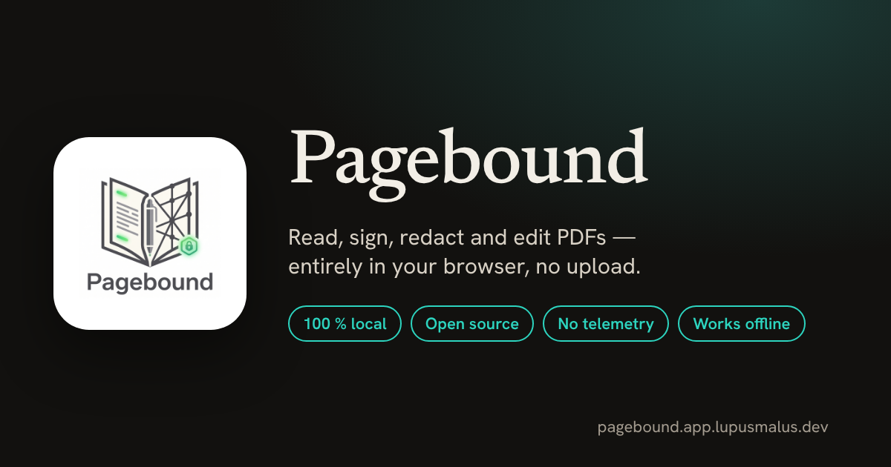

# Pagebound — the private PDF tool that runs entirely in your browser

[English](README.md) · **[Deutsch](README.de.md)**

**Read, annotate, sign, redact and edit PDFs without uploading them anywhere.**

Pagebound is an open-source replacement for a desktop PDF reader, built as an installable,
offline-capable web app (PWA). Every operation runs **on your device** — there is no server that
sees your files, no account, no telemetry, no ads and no third-party scripts or fonts.

**▶ Try it: [pagebound.app.lupusmalus.dev](https://pagebound.app.lupusmalus.dev/?lang=en)** — or self-host it with Docker in one command.

[](https://github.com/LupusMalusDeviant/Pagebound/actions/workflows/ci.yml)
[](LICENSE)
[](#status)
[](https://dotnet.microsoft.com/)
[](https://learn.microsoft.com/aspnet/core/blazor/)
[](#quick-start)
[](mcp/README.md)

> **Beta — usable for everyday work.** All core features are implemented and covered by unit, component
> and end-to-end tests. Expect polish and breaking changes before `1.0`.

---

## Why Pagebound

Most "free online PDF tools" upload your document to someone else's server. Desktop readers want an
account, push subscriptions or phone home. Pagebound does neither:

| | Typical online PDF tool | Pagebound |
|---|---|---|
| **Where your file goes** | Uploaded to a third-party server | Stays on your device — processed in the browser |
| **Account / paywall** | Often required, "Pro" features locked | None. Everything is free and open source |
| **Tracking** | Analytics, ads, third-party CDNs | None — enforced by CSP `connect-src 'self'` and a CI privacy guard |
| **Offline** | No | Yes — installable PWA, works without a connection |
| **Redaction** | Often just a black box over the text | Content underneath is **removed**, with an optional audit report |
| **Automation** | Paid API | Built-in **MCP server** for AI agents (stdio or hosted, tokenless) |

## Features

- **Reader** — page navigation, zoom, full-text search, outline, thumbnails, night mode, continuous scroll, split view with synchronized scrolling, text-to-speech
- **Annotate** — highlights, sticky notes with Markdown, pen, shapes, free text and date stamps; **flatten** them into the PDF
- **Sign** — draw, **type** (three bundled script fonts) or load an image; signer metadata and an integrity hash in the document
- **Redact** — the content under the box is removed (rasterized pages), optional audit report with SHA-256 before/after
- **Forms** — fill AcroForms (text, checkbox, radio, dropdown, list) and create new form fields
- **Pages** — merge, split, reorder, delete, rotate, compress; images → PDF
- **Convert** — PDF → PNG/JPG, text, HTML, CSV, DOCX/XLSX/PPTX; PDF/A best effort; PDF/UA tagging
- **Security** — AES-256 encryption (ISO 32000-2, WebCrypto), certificate signatures (PAdES-B-B) via the MCP server
- **OCR** — Tesseract.js, fully self-hosted (no CDN), works offline
- **Library** — tags, search, three views, JSON sidecars; Markdown export for Obsidian/Zettelkasten
- **Designer** — WYSIWYG editor for flyers, letters, invoices and slides with themes, overlays, QR codes, CSV mail merge
- **German and English UI**, light/dark theme, accent colours, density and motion settings

Task pages: [delete PDF pages](https://pagebound.app.lupusmalus.dev/en/delete-pdf-pages/) ·
[sign a PDF](https://pagebound.app.lupusmalus.dev/en/sign-pdf/) ·
[redact a PDF](https://pagebound.app.lupusmalus.dev/en/redact-pdf/) ·
[merge PDFs](https://pagebound.app.lupusmalus.dev/en/merge-pdf/)

## Quick start

### Use it

Open **[pagebound.app.lupusmalus.dev](https://pagebound.app.lupusmalus.dev/?lang=en)** and drop a PDF on the page —
you can do that even while the app is still loading. Install it as an app from the browser menu to use it offline.

### Self-host with Docker

```bash
git clone https://github.com/LupusMalusDeviant/Pagebound.git && cd Pagebound
docker build -t pagebound .
docker run --rm -p 8081:80 pagebound
```

Then open http://localhost:8081. The image is a static site behind nginx (with pre-compressed Brotli assets);
no database, no backend.

### Build from source

```bash
cd src/Pagebound.Web
npm ci && npm run build      # CSS + JS bridges
dotnet run                   # requires the .NET 10 SDK and Node 22+
```

See the [deployment guide](docs/04-deployment-guide.md) for TLS, reverse proxies and CI/CD.

## MCP server for AI agents

The [`mcp/`](mcp/README.md) package exposes Pagebound's PDF engines to LLM agents — **tokenless**, over
**stdio** (local) or **Streamable HTTP** (hosted at `https://pagebound.app.lupusmalus.dev/mcp`): page tools,
split/merge, stamping, AES-256 encryption, forms, metadata, PDF/A-2b/3b including ZUGFeRD/Factur-X attachments,
PDF/UA tagging, certificate signatures, text extraction and diff, OCR, tables → CSV, and designer documents
rendered straight to PDF. Output is reproducible (same input → byte-identical PDF) with stable error codes.

```bash
docker run --rm -i -e MCP_TRANSPORT=stdio ghcr.io/lupusmalusdeviant/pagebound-mcp:latest
```

## Performance

Measured cold start (no cache, 4G profile, `/reader`) — see [the measurement log](docs/findings/MESSUNG-2026-11-05-kaltstart.md):

| | before | now |
|---|---|---|
| Ready to use | 12.2 s | **3.9 s** |
| Transferred | 12.4 MB | **3.3 MB** |
| Drop zone accepts a file after | — | **0.2 s** |

Brotli straight from nginx, trimmed .NET assemblies, lazily loaded JS bridges and no ICU data.

## Status

**Beta.** Live at [pagebound.app.lupusmalus.dev](https://pagebound.app.lupusmalus.dev) (app + hosted MCP server).
Planned: app-store packages (Microsoft Store, Google Play — see [the plan](docs/distribution/app-stores.md)),
real PDF/UA structure tagging, PAdES-B-T timestamps, streaming rendering for very large files, `1.0`.

## Architecture

Blazor WebAssembly (.NET 10) with interface-first DI; PDF.js for rendering and pdf-lib for manipulation via
JS interop; AES-256 via WebCrypto; Tesseract.js OCR; IndexedDB + JSON sidecars for persistence; static
hosting (Docker + nginx). Details in the [German README](README.de.md#architektur-kurz) and the
[ADRs](docs/adr/README.md).

## Privacy

No telemetry, no external requests, no cookies, no accounts. Fonts, OCR models and all scripts are
self-hosted; the Content Security Policy only allows the app's own origin, and a CI guard
(`tools/privacy-check.mjs`) fails the build on any external host. See [SECURITY.md](SECURITY.md).

## Contributing

Contributions are welcome — see [CONTRIBUTING.md](CONTRIBUTING.md) and the [Code of Conduct](CODE_OF_CONDUCT.md).
Report security issues privately as described in [SECURITY.md](SECURITY.md).

## License

Apache License 2.0 — see [LICENSE](LICENSE) and third-party notices in [NOTICE](NOTICE).

---

*Pagebound is not affiliated with Adobe Inc. "Adobe", "Acrobat" and "Acrobat Reader" are registered trademarks of Adobe Inc.*
