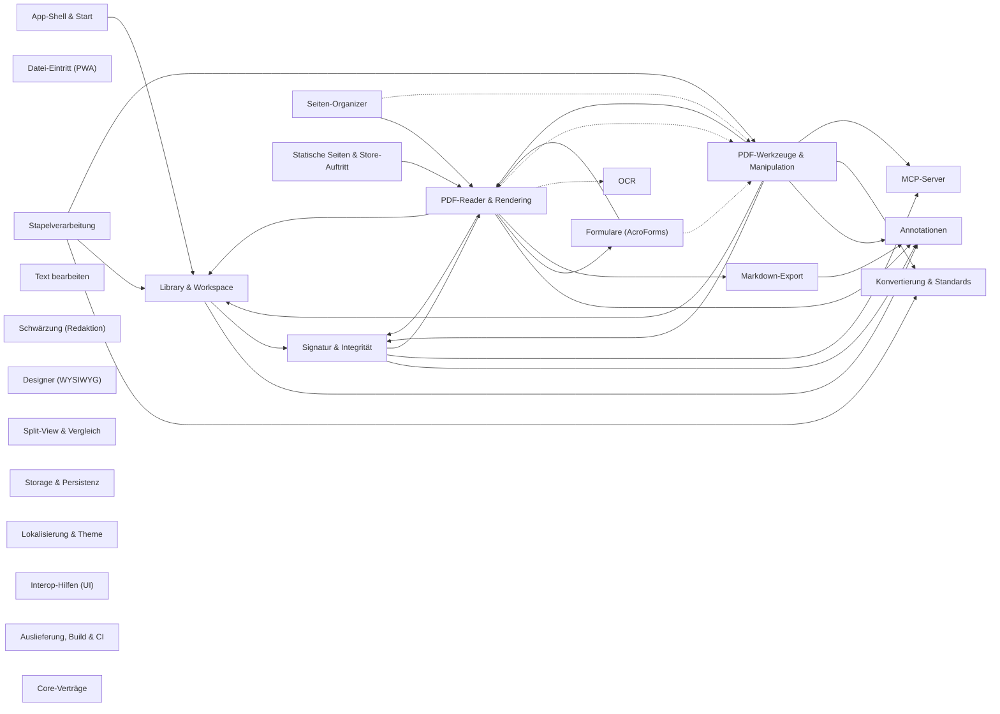

# Codebase-Blueprint

**Repository:** Pagebound (PDF-Tool)
**Generiert:** 2026-11-08, inkrementell nachgezogen 2026-11-12
**Stand (Commit):** 80910d4bf1755c3bbd6ad1abc5fbdb34876bd8c9
**Scope:** Komplettes Repo

## Überblick

Pagebound ist ein quelloffener PDF-Reader und -Editor als Blazor-WebAssembly-PWA (.NET 10), der ohne Backend läuft: Lesen, Annotieren, Signieren, Manipulieren, Konvertieren, OCR und ein WYSIWYG-Designer, alles im Browser. Die Fachlogik liegt in C# (`Pagebound.Core` als Vertragsschicht und Domain, `Pagebound.Infrastructure` als Implementierung), die Arbeit am PDF erledigen TypeScript-Brücken über pdf-lib, PDF.js, Tesseract.js und node-forge. Ausgeliefert wird ein statisches nginx-Abbild mit vorkomprimierten Dateien. Daneben liegt ein eigenständiges Node-Paket unter `mcp/`, das dieselben Fähigkeiten als MCP-Server für LLM-Agenten anbietet, ohne Quelltext mit der Web-App zu teilen.

## Features

| Feature | Kurzbeschreibung | Blueprint |
|---------|------------------|-----------|
| App-Shell & Start | Program.cs mit 24 DI-Registrierungen, Routing, Layout, Einstellungen, Startseite, Lazy-Laden der JS-Brücken | [app-shell.md](./app-shell.md) |
| Datei-Eintritt (PWA) | Ein Eintritt für alle Wege, auf denen eine Datei hereinkommt: Drop-Zone, Dateiauswahl, Dateihandler, Teilen-Ziel | [datei-eintritt.md](./datei-eintritt.md) |
| PDF-Reader & Rendering | PDF.js-Rendering mit Zoom, Suche, Outline, Thumbnails, fortlaufender Ansicht und Vorlesen | [pdf-reader.md](./pdf-reader.md) |
| Annotationen | Highlights, Notizen, Ink, Formen und Freitext als Domain-Objekte, persistiert über IStorageService | [annotationen.md](./annotationen.md) |
| Signatur & Integrität | PNG-Signatur, SHA-256-Integritätsnachweis und zertifikatbasierte PAdES-Signatur mit eigenem CMS-Container | [signatur-integritaet.md](./signatur-integritaet.md) |
| PDF-Werkzeuge & Manipulation | Merge, Split, Rotate, Delete, Stempel, Metadaten, AES-256-Verschlüsselung, Kompression | [pdf-werkzeuge.md](./pdf-werkzeuge.md) |
| Seiten-Organizer | Seiten per Drag neu ordnen, drehen, löschen und als neue PDF speichern (`/organize`) | [seiten-organizer.md](./seiten-organizer.md) |
| Formulare (AcroForms) | Felder lesen, füllen und flatten, plus Form-Builder zum Platzieren neuer Felder | [formulare.md](./formulare.md) |
| Stapelverarbeitung | Regeln (Kompression, Verschlüsselung, Text-Export) auf mehrere PDFs, Ergebnis als ZIP | [batch.md](./batch.md) |
| Konvertierung & Standards | PDF zu Text, HTML, CSV, Bildern, DOCX, XLSX, PPTX, SVG; Bilder zu PDF; PDF/A-2b und PDF/UA-1 | [konvertierung.md](./konvertierung.md) |
| OCR | Tesseract.js, Worker und Sprachdaten self-hosted, mit auswählbarem OCR-Textlayer | [ocr.md](./ocr.md) |
| Text bearbeiten | Inline-Textbearbeitung im Reader über Cover und Redraw, Ergebnis als `.edited.pdf` | [text-bearbeiten.md](./text-bearbeiten.md) |
| Schwärzung (Redaktion) | Destruktive Schwärzung, die den Text wirklich entfernt, mit optionalem Prüfbericht | [redaktion.md](./redaktion.md) |
| Library & Workspace | Bibliothek mit Hash-Identität, Tags und Suche; Sidecar-JSON; optionaler Workspace-Ordner | [library-workspace.md](./library-workspace.md) |
| Markdown-Export | Highlights und Notizen als Obsidian-taugliches Markdown mit YAML-Frontmatter und Wikilinks | [markdown-export.md](./markdown-export.md) |
| Designer (WYSIWYG) | Block-Editor für Flyer, Briefe, Rechnungen und Slides: Vorlagen, Themes, CSV-Serien, QR, Mindmaps | [designer.md](./designer.md) |
| Split-View & Vergleich | Zwei Reader nebeneinander mit synchronem Scrollen, plus Text-Diff zweier PDFs | [split-view-vergleich.md](./split-view-vergleich.md) |
| Storage & Persistenz | IndexedDB für Key-Value und Blobs, File-System-Access-Handles für PDFs | [storage-persistenz.md](./storage-persistenz.md) |
| Lokalisierung & Theme | DE/EN-Textbündel über `L.T()`, hell und dunkel plus Akzentfarben über CSS-Variablen | [lokalisierung-theme.md](./lokalisierung-theme.md) |
| Interop-Hilfen (UI) | Tastaturkürzel, Textauswahl, Drag, Downloads, Zeichenfläche, Signatur-Pad als eine JS-Brücke | [interop-hilfen.md](./interop-hilfen.md) |
| Statische Seiten & Store-Auftritt | Generierte Landing- und Datenschutzseiten, Sitemap, App-Icons, Screenshots, OG-Bilder | [store-auftritt.md](./store-auftritt.md) |
| Auslieferung, Build & CI | esbuild- und Tailwind-Build, Docker mit nginx, Smoke-Prüfungen, Datenschutz-Wächter, GitHub-Workflows | [auslieferung-ci.md](./auslieferung-ci.md) |
| MCP-Server | Eigenständiges Node-Paket mit 30 Tools für LLM-Agenten über stdio und Streamable HTTP | [mcp-server.md](./mcp-server.md) |
| Core-Verträge | 24 Interfaces in `Pagebound.Core/Abstractions`, die Web und Infrastructure trennen | [core-vertraege.md](./core-vertraege.md) |

## Zuordnung

| Feature | Pfade | Rolle |
|---------|-------|-------|
| [App-Shell & Start](./app-shell.md) | `src/Pagebound.Web/Program.cs`, `src/Pagebound.Web/App.razor`, `src/Pagebound.Web/_Imports.razor`, `src/Pagebound.Web/Layout/**`, `src/Pagebound.Web/Pages/**`, `src/Pagebound.Web/wwwroot/index.html`, `src/Pagebound.Web/wwwroot/js/lazy-bridges.js`, `src/Pagebound.Web/wwwroot/css/**` | Querschnitt |
| [Datei-Eintritt (PWA)](./datei-eintritt.md) | `src/Pagebound.Web/wwwroot/js/boot.js`, `src/Pagebound.Web/wwwroot/service-worker.js`, `src/Pagebound.Web/wwwroot/service-worker.published.js`, `src/Pagebound.Web/wwwroot/manifest.webmanifest`, `src/Pagebound.Web/tests-js/boot.test.mjs`, `src/Pagebound.Web/tests-js/service-worker.test.mjs`, `src/Pagebound.Web/tests-js/manifest.test.mjs` | fach |
| [PDF-Reader & Rendering](./pdf-reader.md) | `src/Pagebound.Web/Features/Reader/ReaderPage.razor`, `src/Pagebound.Web/Features/Reader/ReaderPane.razor`, `src/Pagebound.Web/Features/Reader/OutlineNode.razor`, `src/Pagebound.Web/Features/Reader/ToolbarMenu.razor`, `src/Pagebound.Web/Features/Reader/FreeTextEditorPopover.razor`, `src/Pagebound.Infrastructure/Pdf/PdfJsRenderer.cs`, `src/Pagebound.Core/Domain/PdfDocumentTypes.cs`, `src/Pagebound.Web/wwwroot/js/pdfjs-bridge.ts`, `src/Pagebound.Web/wwwroot/js/pdfjs-worker-shim.mjs`, `src/Pagebound.Web/wwwroot/js/tts-bridge.ts`, `src/Pagebound.Web/tests-js/pdfjs-bridge.test.mjs`, `src/Pagebound.Web/tests-js/tts.test.mjs` | fach |
| [Annotationen](./annotationen.md) | `src/Pagebound.Infrastructure/Annotations/**`, `src/Pagebound.Core/Domain/AnnotationPayload.cs`, `src/Pagebound.Core/Domain/AnnotationTypes.cs`, `src/Pagebound.Core/Domain/HighlightAnnotation.cs`, `src/Pagebound.Core/Domain/StickyNoteAnnotation.cs`, `src/Pagebound.Core/Domain/InkAnnotation.cs`, `src/Pagebound.Core/Domain/ShapeAnnotation.cs`, `src/Pagebound.Core/Domain/FreeTextAnnotation.cs` | fach |
| [Signatur & Integrität](./signatur-integritaet.md) | `src/Pagebound.Infrastructure/Crypto/**`, `src/Pagebound.Infrastructure/Pdf/JsPdfSignService.cs`, `src/Pagebound.Web/Features/Reader/SignaturePad.razor`, `src/Pagebound.Core/Domain/SignatureAnnotation.cs`, `src/Pagebound.Core/Domain/SignerInfo.cs`, `src/Pagebound.Core/Domain/HashAlgorithm.cs`, `src/Pagebound.Web/wwwroot/js/sign-bridge.ts`, `tools/cms-verify/*.cs`, `tests/Pagebound.Web.Tests/**` | fach |
| [PDF-Werkzeuge & Manipulation](./pdf-werkzeuge.md) | `src/Pagebound.Web/Features/PdfTools/PdfToolsPage.razor`, `src/Pagebound.Web/Features/PdfTools/PdfToolsPanel.razor`, `src/Pagebound.Infrastructure/Pdf/JsPdfLibManipulator.cs`, `src/Pagebound.Infrastructure/Pdf/JsPdfEncryptor.cs`, `src/Pagebound.Infrastructure/Pdf/Encryption/**`, `src/Pagebound.Core/Domain/PdfManipulatorTypes.cs`, `src/Pagebound.Core/Domain/StampTypes.cs`, `src/Pagebound.Web/wwwroot/js/pdf-manipulator-bridge.ts`, `src/Pagebound.Web/wwwroot/js/page-geometry.ts`, `src/Pagebound.Web/tests-js/geometry.test.mjs` | fach |
| [Seiten-Organizer](./seiten-organizer.md) | `src/Pagebound.Web/Features/PdfTools/OrganizerPage.razor` | fach |
| [Formulare (AcroForms)](./formulare.md) | `src/Pagebound.Web/Features/PdfTools/FormBuilderPage.razor`, `src/Pagebound.Infrastructure/Pdf/JsPdfFormService.cs`, `src/Pagebound.Core/Domain/PdfFormTypes.cs` | fach |
| [Stapelverarbeitung](./batch.md) | `src/Pagebound.Web/Features/PdfTools/BatchPage.razor`, `src/Pagebound.Infrastructure/Pdf/BatchRuleStore.cs`, `src/Pagebound.Core/Domain/BatchRule.cs` | fach |
| [Konvertierung & Standards](./konvertierung.md) | `src/Pagebound.Infrastructure/Pdf/JsPdfConverter.cs`, `src/Pagebound.Infrastructure/Pdf/JsImageToPdfConverter.cs`, `src/Pagebound.Infrastructure/Pdf/JsPdfArchiveService.cs`, `src/Pagebound.Core/Domain/ConversionTypes.cs`, `src/Pagebound.Core/Domain/ImageToPdfTypes.cs` | fach |
| [OCR](./ocr.md) | `src/Pagebound.Infrastructure/Ocr/**`, `src/Pagebound.Core/Domain/OcrTypes.cs`, `src/Pagebound.Web/wwwroot/js/ocr-bridge.ts` | fach |
| [Text bearbeiten](./text-bearbeiten.md) | keine eigenen Dateien, siehe Hinweis unter der Tabelle | fach |
| [Schwärzung (Redaktion)](./redaktion.md) | keine eigenen Dateien, siehe Hinweis unter der Tabelle | fach |
| [Library & Workspace](./library-workspace.md) | `src/Pagebound.Web/Features/Library/**`, `src/Pagebound.Infrastructure/Library/**`, `src/Pagebound.Infrastructure/Workspace/**`, `src/Pagebound.Infrastructure/Sidecars/**`, `src/Pagebound.Core/Domain/LibraryQuery.cs`, `src/Pagebound.Core/Domain/SidecarTypes.cs`, `src/Pagebound.Core/Text/**`, `src/Pagebound.Web/wwwroot/js/workspace-bridge.ts` | fach |
| [Markdown-Export](./markdown-export.md) | `src/Pagebound.Infrastructure/Export/**` | fach |
| [Designer (WYSIWYG)](./designer.md) | `src/Pagebound.Web/Features/Editor/**`, `src/Pagebound.Infrastructure/Editor/**`, `src/Pagebound.Core/Domain/EditorDocument.cs`, `src/Pagebound.Core/Domain/EditorLayouts.cs`, `src/Pagebound.Core/Domain/EditorSeries.cs`, `src/Pagebound.Core/Domain/EditorTemplates.cs`, `src/Pagebound.Core/Domain/EditorTheme.cs`, `src/Pagebound.Core/Domain/EditorDesignDefaults.cs`, `src/Pagebound.Web/wwwroot/js/wysiwyg-editor.ts`, `src/Pagebound.Web/wwwroot/js/mind-bridge.ts`, `src/Pagebound.Web/wwwroot/js/designs-bridge.ts` | fach |
| [Split-View & Vergleich](./split-view-vergleich.md) | `src/Pagebound.Web/Features/Reader/SplitViewPage.razor`, `src/Pagebound.Web/Features/Reader/ComparePage.razor`, `src/Pagebound.Web/Features/Reader/PdfDiffResultView.razor`, `src/Pagebound.Web/Features/Reader/PdfTextDiff.cs`, `src/Pagebound.Web/wwwroot/js/split-bridge.ts` | fach |
| [Storage & Persistenz](./storage-persistenz.md) | `src/Pagebound.Infrastructure/Storage/**`, `src/Pagebound.Web/wwwroot/js/storage-bridge.ts`, `src/Pagebound.Web/wwwroot/js/file-handle-bridge.ts` | Querschnitt |
| [Lokalisierung & Theme](./lokalisierung-theme.md) | `src/Pagebound.Infrastructure/Localization/**`, `src/Pagebound.Infrastructure/Theme/**`, `src/Pagebound.Core/Domain/ThemeName.cs`, `src/Pagebound.Web/wwwroot/resources/**` | Querschnitt |
| [Interop-Hilfen (UI)](./interop-hilfen.md) | `src/Pagebound.Web/wwwroot/js/shortcuts-bridge.ts`, `src/Pagebound.Web/wwwroot/js/tweaks-bridge.ts`, `src/Pagebound.Web/wwwroot/js/types.d.ts` | Querschnitt |
| [Statische Seiten & Store-Auftritt](./store-auftritt.md) | `tools/gen-landing.mjs`, `tools/app-icons/**`, `tools/og-image/**`, `src/Pagebound.Web/wwwroot/landing/**`, `src/Pagebound.Web/wwwroot/datenschutz/**`, `src/Pagebound.Web/wwwroot/en/**`, `src/Pagebound.Web/wwwroot/.well-known/**`, `src/Pagebound.Web/wwwroot/pdf-schwaerzen/**`, `src/Pagebound.Web/wwwroot/pdf-seiten-loeschen/**`, `src/Pagebound.Web/wwwroot/pdf-unterschreiben/**`, `src/Pagebound.Web/wwwroot/pdf-zusammenfuegen/**`, `src/Pagebound.Web/tests-js/landing.test.mjs` | fach |
| [Auslieferung, Build & CI](./auslieferung-ci.md) | `Dockerfile`, `infra/**`, `.github/workflows/**`, `src/Pagebound.Web/esbuild.mjs`, `tools/privacy-check.mjs`, `src/Pagebound.Infrastructure/Telemetry/**` | Querschnitt |
| [MCP-Server](./mcp-server.md) | `mcp/src/**`, `mcp/testdata/**`, `mcp/Dockerfile`, `src/Pagebound.Web/tests-js/repo-meta.test.mjs` | fach |
| [Core-Verträge](./core-vertraege.md) | `src/Pagebound.Core/Abstractions/**` | Vertrag |

Jede Quelldatei gehört zu genau einem Feature; der spezifischste Glob gewinnt. Rolle: `fach`, `Vertrag` (reine Interfaces und Modelle) oder `Querschnitt` (Settings, Audit, Logging).

**Zwei Features ohne eigene Dateien.** „Text bearbeiten" und „Schwärzung" liegen als Symbole in Dateien, die anderen Features zugeordnet sind: `ReaderPane.ApplyTextEditsAsync` und `ReaderPane.ApplyRedactionsAsync` in `src/Pagebound.Web/Features/Reader/ReaderPane.razor`, dazu `ApplyTextEditsAsync` und `RedactAsync` in `src/Pagebound.Infrastructure/Pdf/JsPdfLibManipulator.cs`. Beide Features erscheinen deshalb **nicht** im maschinell geprüften Kantengraph, und ihre internen Abhängigkeiten in den Feature-Dateien sind von Hand ermittelt, nicht vom Skript. Wer eine Änderung an ihnen verfolgen will, geht über die Kanten von „PDF-Reader & Rendering" und „PDF-Werkzeuge & Manipulation".

**Bewusste Reste.** Nicht zugeordnet bleiben: `src/Pagebound.Web/wwwroot/fonts/**`, `tessdata/**`, `screenshots/**` und die Icon- und OG-Bilder (Binärdateien ohne Quelltext), `src/Pagebound.Core/Application/README.md` (leerer Platzhalterordner), die Build-Ausgaben unter `tools/cms-verify/bin|obj` sowie die unversionierten Hilfsskripte `mcp/lies.mjs`, `mcp/pruef.mjs` und `mcp/rg.mjs`, die Pfade außerhalb dieses Repos lesen und nicht zum Produkt gehören. Drei weitere Dateien bleiben absichtlich draußen, weil ihre Zuordnung falsche Kanten erzeugt:

- `src/Pagebound.Web/wwwroot/tesseract/worker.min.js` und `tesseract-core-simd-lstm.wasm.js`: mitgelieferte, minifizierte Fremdbündel von Tesseract.js. Sie gehören fachlich zu OCR, aber als minifizierter Code ziehen sie Namenskollisionen mit halb der Codebase an.
- `src/Pagebound.Web/tests-js/pdfjs-stub.mjs`: eine Attrappe, die `getDocument` und `GlobalWorkerOptions` als eigene Symbole deklariert. Jedes Feature, dem sie zugeordnet wird, bekommt dadurch Scheinkanten von allem, was PDF.js benutzt. Sie gehört zu `geometry.test.mjs` in „PDF-Werkzeuge & Manipulation".

## Kanten (geprüft)

| Von | Nach | Art | via | Beleg |
|-----|------|-----|-----|-------|
| [Annotationen](./annotationen.md) | [Storage & Persistenz](./storage-persistenz.md) | Querschnitt | `IStorageService` | `src/Pagebound.Infrastructure/Annotations/AnnotationService.cs:20` |
| [App-Shell & Start](./app-shell.md) | [Interop-Hilfen (UI)](./interop-hilfen.md) | Querschnitt | `load`, `apply` | `src/Pagebound.Web/Layout/MainLayout.razor:281` |
| [App-Shell & Start](./app-shell.md) | [Library & Workspace](./library-workspace.md) | Typ, Laufzeit | `ILibraryService`, `LibraryEntry`, `PdfMeta`, `LibraryQuery`, `LibrarySort` | `src/Pagebound.Web/Layout/MainLayout.razor:4` |
| [App-Shell & Start](./app-shell.md) | [Lokalisierung & Theme](./lokalisierung-theme.md) | Querschnitt | `ILocalizationService` | `src/Pagebound.Web/Layout/MainLayout.razor:3` |
| [Stapelverarbeitung](./batch.md) | [Interop-Hilfen (UI)](./interop-hilfen.md) | Querschnitt | `save` | `src/Pagebound.Web/Features/PdfTools/BatchPage.razor:101` |
| [Stapelverarbeitung](./batch.md) | [Konvertierung & Standards](./konvertierung.md) | Typ, Laufzeit | `IPdfConverter`, `ConversionFormat` | `src/Pagebound.Web/Features/PdfTools/BatchPage.razor:4` |
| [Stapelverarbeitung](./batch.md) | [Library & Workspace](./library-workspace.md) | Typ | `ByteSizeFormatter` | `src/Pagebound.Web/Features/PdfTools/BatchPage.razor:304` |
| [Stapelverarbeitung](./batch.md) | [Lokalisierung & Theme](./lokalisierung-theme.md) | Querschnitt | `ILocalizationService` | `src/Pagebound.Web/Features/PdfTools/BatchPage.razor:6` |
| [Stapelverarbeitung](./batch.md) | [PDF-Werkzeuge & Manipulation](./pdf-werkzeuge.md) | Typ, Laufzeit | `IPdfManipulator`, `CompressionOptions`, `EncryptionOptions` | `src/Pagebound.Web/Features/PdfTools/BatchPage.razor:3` |
| [Stapelverarbeitung](./batch.md) | [Storage & Persistenz](./storage-persistenz.md) | Querschnitt | `IStorageService` | `src/Pagebound.Infrastructure/Pdf/BatchRuleStore.cs:16` |
| [Datei-Eintritt (PWA)](./datei-eintritt.md) | [Interop-Hilfen (UI)](./interop-hilfen.md) | Querschnitt | `load` | `src/Pagebound.Web/wwwroot/js/boot.js:581` |
| [Designer (WYSIWYG)](./designer.md) | [Interop-Hilfen (UI)](./interop-hilfen.md) | Querschnitt | `apply`, `save`, `load`, `downloadBytes` | `src/Pagebound.Web/Features/Editor/DesignerPage.razor:264` |
| [Designer (WYSIWYG)](./designer.md) | [Lokalisierung & Theme](./lokalisierung-theme.md) | Querschnitt | `ILocalizationService` | `src/Pagebound.Web/Features/Editor/DesignerPage.razor:13` |
| [Designer (WYSIWYG)](./designer.md) | [Storage & Persistenz](./storage-persistenz.md) | Querschnitt | `IStorageService` | `src/Pagebound.Infrastructure/Editor/EditorDraftService.cs:16` |
| [Formulare (AcroForms)](./formulare.md) | [Interop-Hilfen (UI)](./interop-hilfen.md) | Querschnitt | `init` | `src/Pagebound.Infrastructure/Pdf/JsPdfFormService.cs:119` |
| [Formulare (AcroForms)](./formulare.md) | [Lokalisierung & Theme](./lokalisierung-theme.md) | Querschnitt | `ILocalizationService` | `src/Pagebound.Web/Features/PdfTools/FormBuilderPage.razor:6` |
| [Formulare (AcroForms)](./formulare.md) | [PDF-Reader & Rendering](./pdf-reader.md) | Typ | `LoadResult`, `registerFormBuilder` | `src/Pagebound.Web/Features/PdfTools/FormBuilderPage.razor:145` |
| [Formulare (AcroForms)](./formulare.md) | [PDF-Werkzeuge & Manipulation](./pdf-werkzeuge.md) | Laufzeit | `IPdfManipulator` | `src/Pagebound.Web/Features/PdfTools/FormBuilderPage.razor:5` |
| [Konvertierung & Standards](./konvertierung.md) | [Interop-Hilfen (UI)](./interop-hilfen.md) | Querschnitt | `init` | `src/Pagebound.Infrastructure/Pdf/JsImageToPdfConverter.cs:62` |
| [Library & Workspace](./library-workspace.md) | [Annotationen](./annotationen.md) | Typ | `Annotation` | `src/Pagebound.Core/Domain/SidecarTypes.cs:64` |
| [Library & Workspace](./library-workspace.md) | [Lokalisierung & Theme](./lokalisierung-theme.md) | Querschnitt | `ILocalizationService` | `src/Pagebound.Web/Features/Library/LibraryPage.razor:6` |
| [Library & Workspace](./library-workspace.md) | [Signatur & Integrität](./signatur-integritaet.md) | Typ | `HashAlgorithm` | `src/Pagebound.Core/Domain/SidecarTypes.cs:38` |
| [Library & Workspace](./library-workspace.md) | [Storage & Persistenz](./storage-persistenz.md) | Querschnitt | `IStorageService`, `IFileHandleService` | `src/Pagebound.Infrastructure/Library/LibraryService.cs:27` |
| [Lokalisierung & Theme](./lokalisierung-theme.md) | [Interop-Hilfen (UI)](./interop-hilfen.md) | Querschnitt | `getStorage`, `setStorage`, `reload`, `applyTheme` | `src/Pagebound.Infrastructure/Localization/LocalizationService.cs:48` |
| [Markdown-Export](./markdown-export.md) | [Annotationen](./annotationen.md) | Typ, Laufzeit | `IAnnotationService`, `AnnotationType`, `Annotation`, `HighlightAnnotation`, `StickyNoteAnnotation` | `src/Pagebound.Infrastructure/Export/MarkdownExporter.cs:18` |
| [MCP-Server](./mcp-server.md) | [Interop-Hilfen (UI)](./interop-hilfen.md) | Querschnitt | `save`, `load`, `register` | `mcp/src/design-pdf.ts:975` |
| [PDF-Reader & Rendering](./pdf-reader.md) | [Annotationen](./annotationen.md) | Typ, Laufzeit | `IAnnotationService`, `AnnotationType`, `HighlightAnnotation`, `InkAnnotation`, `ShapeAnnotation` | `src/Pagebound.Web/Features/Reader/ReaderPane.razor:9` |
| [PDF-Reader & Rendering](./pdf-reader.md) | [Formulare (AcroForms)](./formulare.md) | Typ, Laufzeit | `IPdfFormService`, `PdfFormFieldType`, `PdfFormField`, `FillFormOptions`, `FormSaveMode` | `src/Pagebound.Web/Features/Reader/ReaderPane.razor:18` |
| [PDF-Reader & Rendering](./pdf-reader.md) | [Interop-Hilfen (UI)](./interop-hilfen.md) | Querschnitt | `save`, `registerDownloadObserver`, `unregisterDownloadObserver`, `load`, `apply` | `src/Pagebound.Web/Features/Reader/FreeTextEditorPopover.razor:66` |
| [PDF-Reader & Rendering](./pdf-reader.md) | [Library & Workspace](./library-workspace.md) | Typ, Laufzeit | `ISidecarService`, `Sidecar`, `IWorkspaceService`, `ILibraryService`, `PdfMeta` | `src/Pagebound.Web/Features/Reader/ReaderPane.razor:13` |
| [PDF-Reader & Rendering](./pdf-reader.md) | [Lokalisierung & Theme](./lokalisierung-theme.md) | Querschnitt | `ILocalizationService` | `src/Pagebound.Web/Features/Reader/FreeTextEditorPopover.razor:1` |
| [PDF-Reader & Rendering](./pdf-reader.md) | [Markdown-Export](./markdown-export.md) | Typ, Laufzeit | `IMarkdownExporter`, `MarkdownExporter` | `src/Pagebound.Web/Features/Reader/ReaderPane.razor:10` |
| [PDF-Reader & Rendering](./pdf-reader.md) | [OCR](./ocr.md) | Laufzeit | `IOcrService` | `src/Pagebound.Web/Features/Reader/ReaderPane.razor:16` |
| [PDF-Reader & Rendering](./pdf-reader.md) | [PDF-Werkzeuge & Manipulation](./pdf-werkzeuge.md) | Laufzeit | `IPdfManipulator` | `src/Pagebound.Web/Features/Reader/ReaderPane.razor:7` |
| [PDF-Reader & Rendering](./pdf-reader.md) | [Signatur & Integrität](./signatur-integritaet.md) | Typ, Laufzeit | `IHashService`, `IIntegrityService`, `SignatureAnnotation`, `SignatureIntegrityStatus`, `HashAlgorithm` | `src/Pagebound.Web/Features/Reader/ReaderPane.razor:8` |
| [PDF-Reader & Rendering](./pdf-reader.md) | [Storage & Persistenz](./storage-persistenz.md) | Querschnitt | `IStorageService`, `IFileHandleService` | `src/Pagebound.Web/Features/Reader/ReaderPane.razor:12` |
| [PDF-Werkzeuge & Manipulation](./pdf-werkzeuge.md) | [Annotationen](./annotationen.md) | Typ | `Annotation`, `AnnotationType`, `HighlightAnnotation`, `InkAnnotation`, `ShapeAnnotation` | `src/Pagebound.Infrastructure/Pdf/JsPdfLibManipulator.cs:220` |
| [PDF-Werkzeuge & Manipulation](./pdf-werkzeuge.md) | [Interop-Hilfen (UI)](./interop-hilfen.md) | Querschnitt | `init`, `save`, `apply`, `load`, `downloadBytes` | `src/Pagebound.Infrastructure/Pdf/JsPdfLibManipulator.cs:522` |
| [PDF-Werkzeuge & Manipulation](./pdf-werkzeuge.md) | [Konvertierung & Standards](./konvertierung.md) | Typ, Laufzeit | `IImageToPdfConverter`, `IPdfConverter`, `IPdfArchiveService`, `ConversionFormat`, `PdfPageSizeMode` | `src/Pagebound.Web/Features/PdfTools/PdfToolsPanel.razor:6` |
| [PDF-Werkzeuge & Manipulation](./pdf-werkzeuge.md) | [Library & Workspace](./library-workspace.md) | Typ | `ByteSizeFormatter` | `src/Pagebound.Web/Features/PdfTools/PdfToolsPanel.razor:1136` |
| [PDF-Werkzeuge & Manipulation](./pdf-werkzeuge.md) | [Lokalisierung & Theme](./lokalisierung-theme.md) | Querschnitt | `ILocalizationService` | `src/Pagebound.Web/Features/PdfTools/PdfToolsPanel.razor:9` |
| [PDF-Werkzeuge & Manipulation](./pdf-werkzeuge.md) | [MCP-Server](./mcp-server.md) | Typ | `catalog` | `src/Pagebound.Web/wwwroot/js/pdf-manipulator-bridge.ts:1032` |
| [PDF-Werkzeuge & Manipulation](./pdf-werkzeuge.md) | [PDF-Reader & Rendering](./pdf-reader.md) | Typ, Laufzeit | `IPdfRenderer`, `PdfDocumentHandle`, `LoadOptions`, `RenderOptions` | `src/Pagebound.Web/Features/PdfTools/PdfToolsPanel.razor:4` |
| [PDF-Werkzeuge & Manipulation](./pdf-werkzeuge.md) | [Signatur & Integrität](./signatur-integritaet.md) | Typ, Laufzeit | `SignatureAnnotation`, `IPdfSignService` | `src/Pagebound.Infrastructure/Pdf/JsPdfLibManipulator.cs:305` |
| [Seiten-Organizer](./seiten-organizer.md) | [Interop-Hilfen (UI)](./interop-hilfen.md) | Querschnitt | `apply`, `init`, `downloadBytes` | `src/Pagebound.Web/Features/PdfTools/OrganizerPage.razor:27` |
| [Seiten-Organizer](./seiten-organizer.md) | [Lokalisierung & Theme](./lokalisierung-theme.md) | Querschnitt | `ILocalizationService` | `src/Pagebound.Web/Features/PdfTools/OrganizerPage.razor:5` |
| [Seiten-Organizer](./seiten-organizer.md) | [PDF-Reader & Rendering](./pdf-reader.md) | Typ | `LoadResult` | `src/Pagebound.Web/Features/PdfTools/OrganizerPage.razor:93` |
| [Seiten-Organizer](./seiten-organizer.md) | [PDF-Werkzeuge & Manipulation](./pdf-werkzeuge.md) | Laufzeit | `IPdfManipulator` | `src/Pagebound.Web/Features/PdfTools/OrganizerPage.razor:4` |
| [Signatur & Integrität](./signatur-integritaet.md) | [Annotationen](./annotationen.md) | Typ | `NewAnnotation`, `AnnotationType`, `Annotation`, `AnnotationPayload` | `src/Pagebound.Core/Domain/SignatureAnnotation.cs:52` |
| [Signatur & Integrität](./signatur-integritaet.md) | [Interop-Hilfen (UI)](./interop-hilfen.md) | Querschnitt | `initSignaturePad`, `clearSignaturePad`, `getSignatureDataUrl`, `disposeSignaturePad`, `load` | `src/Pagebound.Web/Features/Reader/SignaturePad.razor:138` |
| [Signatur & Integrität](./signatur-integritaet.md) | [Lokalisierung & Theme](./lokalisierung-theme.md) | Querschnitt | `ILocalizationService` | `src/Pagebound.Web/Features/Reader/SignaturePad.razor:2` |
| [Signatur & Integrität](./signatur-integritaet.md) | [MCP-Server](./mcp-server.md) | Typ | `catalog` | `src/Pagebound.Web/wwwroot/js/sign-bridge.ts:522` |
| [Signatur & Integrität](./signatur-integritaet.md) | [PDF-Reader & Rendering](./pdf-reader.md) | Typ | `cancel` | `src/Pagebound.Web/Features/Reader/SignaturePad.razor:80` |
| [Split-View & Vergleich](./split-view-vergleich.md) | [Lokalisierung & Theme](./lokalisierung-theme.md) | Querschnitt | `ILocalizationService` | `src/Pagebound.Web/Features/Reader/ComparePage.razor:3` |
| [Statische Seiten & Store-Auftritt](./store-auftritt.md) | [Interop-Hilfen (UI)](./interop-hilfen.md) | Querschnitt | `load`, `save` | `tools/app-icons/screenshots.mjs:59` |
| [Statische Seiten & Store-Auftritt](./store-auftritt.md) | [PDF-Reader & Rendering](./pdf-reader.md) | Typ | `speak` | `tools/gen-landing.mjs:304` |

Pfeil = „benutzt“. Durchgezogen: Build- oder Typ-Kante; gestrichelt: nur zur Laufzeit über ein Interface (DI) oder einen HTTP-Endpunkt. Eine HTTP-Kante heißt: Die Quelle nennt eine Route des Ziels; ob diese Stelle zur Laufzeit erreicht wird und ob die genaue Unterroute existiert, zeigt erst der Code. Querschnitt-Kanten (Settings, Audit, Identity, Logging) stehen nur in der Tabelle.

**Vier Kanten in der Tabelle sind Namensgleichheiten, keine Abhängigkeiten.** Das Skript vergleicht Symbolnamen und kann über eine Paketgrenze hinweg nicht sehen, dass zwei gleich benannte Symbole nichts miteinander zu tun haben. Geprüft und widerlegt:

| Kante | via | Warum sie nicht stimmt |
|-------|-----|------------------------|
| PDF-Werkzeuge → MCP-Server | `catalog` | `src/Pagebound.Web/wwwroot/js/pdf-manipulator-bridge.ts:1032` ist eine lokale Variable auf `doc.catalog` von pdf-lib. Gemeint wäre `catalog()` aus `mcp/src/design.ts:394`. |
| Signatur & Integrität → MCP-Server | `catalog` | `src/Pagebound.Web/wwwroot/js/sign-bridge.ts:522` greift auf `doc.catalog` von pdf-lib zu, dieselbe Verwechslung. |
| MCP-Server → Interop-Hilfen (UI) | `save`, `load`, `register` | `mcp/src/design-pdf.ts:975` nutzt pdf-lib und fontkit. Die Brücken exportieren Funktionen mit denselben kurzen Namen. |
| Statische Seiten & Store-Auftritt → PDF-Reader & Rendering | `speak` | `tools/gen-landing.mjs:304` ist Seitentext über das Vorlesen, keine Nutzung von `speak()` aus `tts-bridge.ts`. |

Das MCP-Paket teilt **keinen** Quelltext mit der Web-App. Es spiegelt die Funktionen mit denselben npm-Bibliotheken in Node und kann deshalb auseinanderlaufen; die Kommentare in `mcp/src/encrypt.ts:3`, `pdfa.ts:32`, `pdfua.ts:19`, `sign.ts:34` und `ocr.ts:4` benennen jeweils ihr Gegenstück in der PWA.

Die beiden Features **Text bearbeiten** und **Schwärzung (Redaktion)** stehen im Graph als Knoten ohne Kanten, weil sie keine eigenen Dateien haben (siehe den Hinweis unter „Zuordnung"). Ihre Abhängigkeiten stehen in ihren Feature-Dateien und sind von Hand ermittelt.

**Eine Kopplung, die der Graph grundsätzlich nicht sieht: CSS.** Das Telefon-Layout von Reader, Designer und Split-View liegt in `src/Pagebound.Web/wwwroot/css/app.src.css`, also im Feature [App-Shell & Start](./app-shell.md) (Entscheidung vom 2026-11-08, `CLAUDE.md` unter „Style-Regeln"). Die Feature-Dateien setzen nur Klassen. Das Skript vergleicht Symbole und Routen, keine CSS-Selektoren, deshalb gibt es dorthin keine Kante. Wer `app.src.css` ändert, prüft die Tabelle im Abschnitt „Telefon-Layout" von [App-Shell & Start](./app-shell.md) mit. Dasselbe gilt für die Komponentengrenze zwischen Split-View und `ReaderPane`.

## Externe Kern-Dependencies

- `pdf-lib`: Manipulation, Formulare, Signatur-Einbettung, PDF/A und PDF/UA, Verschlüsselung; genutzt in PDF-Werkzeuge, Formulare, Konvertierung, Signatur und MCP-Server
- `pdfjs-dist`: Rendering, Textextraktion, Geometrie; genutzt in PDF-Reader, PDF-Werkzeuge, Konvertierung und MCP-Server
- `tesseract.js`: OCR, vollständig self-hosted ohne CDN; genutzt in OCR und MCP-Server
- `node-forge`: CMS- und ASN.1-Aufbau der zertifikatbasierten Signatur; genutzt in Signatur & Integrität und MCP-Server
- `fontkit`: Font-Einbettung bei Stempeln und PDF/A; genutzt in PDF-Werkzeuge und MCP-Server
- `esbuild`, `tailwindcss`, `typescript`: Build der JS-Brücken und des CSS; genutzt in Auslieferung, Build & CI
- `Markdig` (NuGet): Markdown-Rendering der Notizen mit abgeschaltetem HTML; genutzt in Annotationen

## Wie diese Doku gepflegt wird

Diese Blueprints erzeugt der Mod `codebase-map` (Claude Code).

- Bei Änderungen am Code: „aktualisiere den Blueprint" oder `/codebase-map update`. Claude vergleicht den Code per `git diff` mit dem Commit-Stamp oben und schreibt nur die betroffenen Features neu.
- Aktualitäts-Check ohne Schreiben: „ist der Blueprint noch aktuell?" oder `/codebase-map check`. Claude berichtet, welche Features seit dem Stamp veraltet sind.
- Manuelle Ergänzungen in `<feature-slug>.md` bleiben erhalten: unveränderte Features werden nicht angefasst, und beim Neuschreiben eines veralteten Features werden manuelle Abschnitte übernommen.

## Verwandte Doku

- [CLAUDE.md](../../CLAUDE.md): Arbeitsanweisungen für Claude-Code-Sessions in diesem Projekt
- [README.md](../../README.md): Feature-Überblick und Quickstart
- [SECURITY.md](../../SECURITY.md): Bedrohungsmodell und was die Datenschutzzusage deckt
- [docs/contracts/datei-eintritt.md](../contracts/datei-eintritt.md): abgenommener Vertrag für den Datei-Eintritt samt vier Nachträgen
- [docs/04-deployment-guide.md](../04-deployment-guide.md): Docker, CI/CD, TLS
- [docs/05-benutzerhandbuch.md](../05-benutzerhandbuch.md): Benutzerhandbuch (DE)
- [mcp/README.md](../../mcp/README.md): Referenz des MCP-Servers
