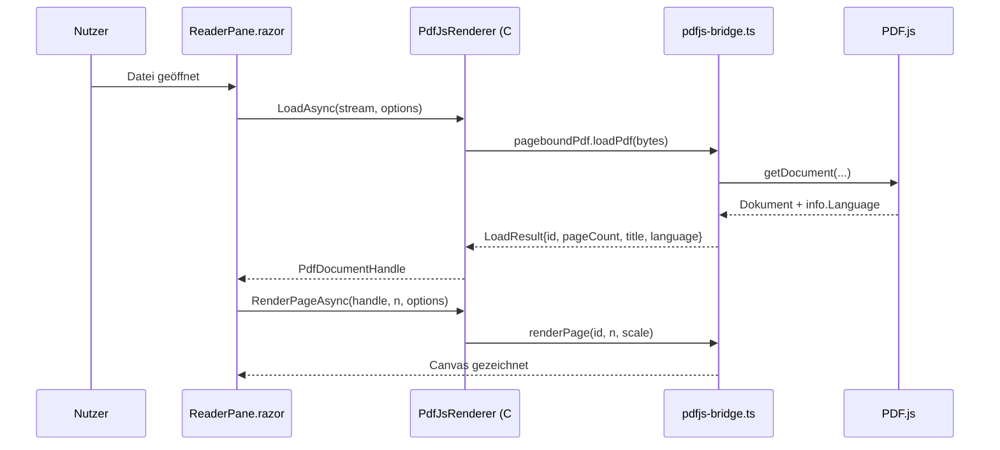

# PDF-Reader & Rendering

## Zweck

Das Herzstück: PDF.js rendert Seiten auf Canvas, dazu Zoom, Suche, Outline, Thumbnails, fortlaufende Ansicht und Vorlesen. `ReaderPane.razor` ist die eine Komponente, in der fast alle Werkzeuge zusammenlaufen (Annotationen, Formulare, OCR, Signatur, Schwärzung, Text bearbeiten) — deshalb ist sie mit 4415 Zeilen die größte Datei der Codebase und der Ort, an dem Änderungen am ehesten andere Features berühren.

## Dateien

| Pfad | Rolle |
|------|-------|
| `src/Pagebound.Web/Features/Reader/ReaderPage.razor` | Seite `/reader` (`:1`); hält nur den Rahmen, die Logik liegt in `ReaderPane`, weil die Split-View zwei Panes nebeneinander braucht |
| `src/Pagebound.Web/Features/Reader/ReaderPane.razor` | Die Reader-Logik: Rendering, Zoom, Suche, Outline, Thumbnails, Modi für alle Werkzeuge (4415 Zeilen) |
| `src/Pagebound.Web/Features/Reader/OutlineNode.razor` | Ein Knoten des Inhaltsverzeichnisses, rekursiv |
| `src/Pagebound.Web/Features/Reader/ToolbarMenu.razor` | Werkzeugleiste des Readers |
| `src/Pagebound.Web/Features/Reader/FreeTextEditorPopover.razor` | Popover für Freitext; auch von „Text bearbeiten" wiederverwendet |
| `src/Pagebound.Infrastructure/Pdf/PdfJsRenderer.cs` | `IPdfRenderer` über die PDF.js-Brücke; `LoadDto` trägt Id, Seitenzahl, Titel und Sprache |
| `src/Pagebound.Core/Domain/PdfDocumentTypes.cs` | `PdfDocumentHandle(Id, PageCount, Title?, Language?)`, `LoadOptions`, `RenderOptions`, `TextItem`, `SearchHit`, `PdfOutline` |
| `src/Pagebound.Web/wwwroot/js/pdfjs-bridge.ts` | PDF.js-Brücke: `loadPdf` (`:70`), `renderPage` (`:103`), `getOutline` (`:160`), `unload` (`:194`), `extractText` (`:317`), `pageText` (`:335`), `findTextBlockAt` (`:358`) |
| `src/Pagebound.Web/wwwroot/js/pdfjs-worker-shim.mjs` | Setzt `workerSrc` auf den mitgelieferten Worker (kein CDN) |
| `src/Pagebound.Web/wwwroot/js/tts-bridge.ts` | Vorlesen: `speak` (`:91`), `pause` (`:125`), `resume` (`:129`), `cancel` (`:133`), `listVoices` (`:48`) |
| `src/Pagebound.Web/tests-js/pdfjs-bridge.test.mjs` | Prüft gegen **echtes** PDF.js an einem echten PDF, dass `/Lang` als `info.Language` ankommt |
| `src/Pagebound.Web/tests-js/tts.test.mjs` | 11 Prüfungen zum Vorlesen, darunter die Weitergabe der Dokumentsprache |

## Abhängigkeiten

### Intern (andere Features dieses Repos)

- **Annotationen** (Typ, Laufzeit, via `IAnnotationService`, `AnnotationType`, `HighlightAnnotation`, `InkAnnotation`, `ShapeAnnotation`): Zeichnen und Anzeigen der Annotationen über der Seite — `src/Pagebound.Web/Features/Reader/ReaderPane.razor:9`. Siehe [`./annotationen.md`](./annotationen.md).
- **Formulare (AcroForms)** (Typ, Laufzeit, via `IPdfFormService`, `PdfFormFieldType`, `PdfFormField`, `FillFormOptions`, `FormSaveMode`): Formular-Panel im Reader — `…/ReaderPane.razor:18`. Siehe [`./formulare.md`](./formulare.md).
- **Library & Workspace** (Typ, Laufzeit, via `ISidecarService`, `Sidecar`, `IWorkspaceService`, `ILibraryService`, `PdfMeta`): Sidecar laden und speichern, Bibliothekseintrag berühren — `…/ReaderPane.razor:13`. Siehe [`./library-workspace.md`](./library-workspace.md).
- **Markdown-Export** (Typ, Laufzeit, via `IMarkdownExporter`, `MarkdownExporter`): Export der Annotationen aus dem Reader — `…/ReaderPane.razor:10`. Siehe [`./markdown-export.md`](./markdown-export.md).
- **OCR** (Laufzeit, via `IOcrService`): Seite als Bild erkennen, Textlayer legen — `…/ReaderPane.razor:16`. Siehe [`./ocr.md`](./ocr.md).
- **PDF-Werkzeuge & Manipulation** (Laufzeit, via `IPdfManipulator`): Schwärzen, Text bearbeiten, Annotationen einbrennen — `…/ReaderPane.razor:7`. Siehe [`./pdf-werkzeuge.md`](./pdf-werkzeuge.md).
- **Signatur & Integrität** (Typ, Laufzeit, via `IHashService`, `IIntegrityService`, `SignatureAnnotation`, `SignatureIntegrityStatus`, `HashAlgorithm`): Signatur setzen und prüfen — `…/ReaderPane.razor:8`. Siehe [`./signatur-integritaet.md`](./signatur-integritaet.md).
- **Storage & Persistenz** (Querschnitt, via `IStorageService`, `IFileHandleService`): Bytes-Cache und Datei-Handles — `…/ReaderPane.razor:12`. Siehe [`./storage-persistenz.md`](./storage-persistenz.md).
- **Lokalisierung & Theme** (Querschnitt, via `ILocalizationService`): Texte — `src/Pagebound.Web/Features/Reader/FreeTextEditorPopover.razor:1`. Siehe [`./lokalisierung-theme.md`](./lokalisierung-theme.md).
- **Interop-Hilfen (UI)** (Querschnitt, via `save`, `registerDownloadObserver`, `unregisterDownloadObserver`, `load`, `apply`): Klickposition in Seitenanteile umrechnen, Textauswahl lesen, Downloads beobachten — `…/FreeTextEditorPopover.razor:66`. Siehe [`./interop-hilfen.md`](./interop-hilfen.md).

### Extern (Packages)

- `pdfjs-dist` (self-hosted, Legacy-Build) — Rendering, Text- und Struktur-Extraktion, Outline. Der Worker liegt im Repo; es geht kein Byte an ein CDN.
- Web Speech API (Browser) — Vorlesen; keine Bibliothek.

## Öffentliche API / Interface

```csharp
public interface IPdfRenderer
{
    Task<PdfDocumentHandle> LoadAsync(Stream pdf, LoadOptions options, CancellationToken ct);
    Task<RenderedPage> RenderPageAsync(PdfDocumentHandle handle, int pageNumber, RenderOptions options, CancellationToken ct);
    Task<IReadOnlyList<TextItem>> ExtractTextAsync(PdfDocumentHandle handle, int pageNumber, CancellationToken ct);
    Task<IReadOnlyList<SearchHit>> SearchAsync(PdfDocumentHandle handle, string query, SearchOptions options, CancellationToken ct);
    Task<PdfOutline?> GetOutlineAsync(PdfDocumentHandle handle, CancellationToken ct);
    // …
}

// Domain, src/Pagebound.Core/Domain/PdfDocumentTypes.cs
public sealed record PdfDocumentHandle(string Id, int PageCount, string? Title = null, string? Language = null);
```

JS-Seite (`pdfjs-bridge.ts`): `loadPdf` liefert ein `LoadResult` mit `id`, `pageCount`, `title` und `language`. `language` ist `/Lang` aus dem Dokumentkatalog, von PDF.js als `info.Language` ausgegeben; Leerraum zählt als nicht gesetzt.

## Datenfluss / Call-Flow



1. `LoadAsync` übergibt die Bytes an `loadPdf` (`pdfjs-bridge.ts:70`); das Ergebnis trägt die Dokumentsprache mit.
2. Beim Vorlesen gibt `ReaderPane` `_handle.Language` als vierten Parameter an `pageboundTts.speak` (`tts-bridge.ts:91`). Fehlt `/Lang` — der häufigere Fall —, bleibt es bei der Vorgabe der Plattform; die App-Sprache wird **nicht** als Ersatz genommen, weil eine deutsche Stimme auf einem englischen PDF schlechter ist als die Plattform-Vorgabe.
3. Die Suche läuft über `extractText`/`pageText` (`:317`, `:335`) und trifft nur, was im Textlayer steht; für Scans liefert OCR den Textlayer nachträglich.
4. `unload` gibt den PDF.js-Ladevorgang frei (`:194`) — wichtig, weil ein nicht freigegebener `loadingTask` in WASM Speicher hält.

## Verhalten auf dem Telefon

Das Layout des Readers auf schmalen Schirmen steuern Klassen, die `ReaderPane.razor` setzt, zusammen mit Regeln in `src/Pagebound.Web/wwwroot/css/app.src.css` (Feature [App-Shell & Start](./app-shell.md), keine Symbolkante dorthin):

| Klasse | Wo gesetzt | Wirkung unter 640 px |
|--------|-----------|----------------------|
| `pb-reader` | Wurzel-`<section>`, `ReaderPane.razor:26` | Anker für alle folgenden Regeln |
| `pb-doc-open` | dieselbe Zeile, wenn `_handle` gesetzt ist | Kopfzeile (`pb-reader-head`), Datei-Karte (`pb-reader-opencard`) und Suche (`pb-reader-searchcard`) weichen dem Dokument |
| `pb-panels-open` | dieselbe Zeile, wenn `_phonePanelsOpen` gesetzt ist | holt Datei-Karte und Suche zurück |
| `pb-phone-only` | Schalter in der Werkzeugleiste, `:193` | der Schalter ist nur unter 640 px sichtbar |
| `pb-reader-keyhint` | Absatz mit den Tastenkürzeln | ausgeblendet unter `(hover: none) and (pointer: coarse)` |
| `pb-reader-stage` | Fläche mit Gliederung und Seite | Gliederung über statt neben der Seite; Innenabstand der Figur reduziert |

Grund: gemessen am 2026-11-08 begann die gerenderte Seite bei 375 Punkt Breite erst nach 630 Punkt Bedienelementen, also außerhalb des Sichtfelds. Der Zustand steckt in `_phonePanelsOpen` (`ReaderPane.razor`), die Darstellung ausschließlich in CSS. Die Entscheidung, Telefon-Layout in `app.src.css` statt als Responsive-Präfixe im Markup zu halten, steht in `CLAUDE.md` unter „Style-Regeln" und ausführlich in `docs/plans/2026-11-08-smartphone-layout.md`.

Die Seitenbreite ergibt sich nicht aus dem Zoom: der Canvas trägt `width: min(100%, <Rasterbreite>px)`, was auf dem Telefon immer zu 100 Prozent auflöst. Was dort Breite kostet, ist Innenabstand.

## Offene Fragen / TODOs

- Keine Virtualisierung der Seitenliste: Thumbnails und fortlaufende Ansicht halten gerenderte Seiten in Dictionaries. Bei großen PDFs ist das der erste Kandidat für einen Speicherausfall; die Leitplanke dazu steht in `.claude/lessons-learned.md`.
- `ReaderPane.razor` bündelt zehn Features in einer Datei. Jede Änderung dort trifft potenziell alle; der Kantengraph zeigt zehn ausgehende Kanten allein von dieser Komponente.
- Die Prüfung der Sprach-Weitergabe in `tts.test.mjs` arbeitet am **Quelltext** des Readers, nicht zur Laufzeit. Sie findet, wenn jemand den Parameter entfernt, nicht, ob der Wert zur Laufzeit ankommt — im Test selbst als schwächstes Glied benannt.
