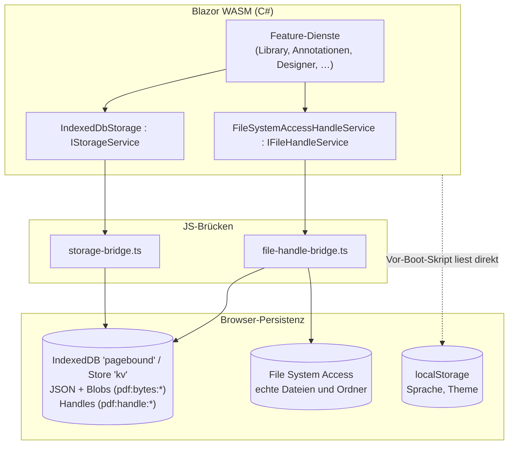

# Storage & Persistenz

## Zweck

Die Persistenzschicht der PWA — alles bleibt lokal im Browser, es gibt keinen Server. Drei Mechanismen, bewusst getrennt:

1. **IndexedDB** (Datenbank `pagebound`, Speicher `kv`): Schlüssel-Wert. Objekte liegen als JSON-Zeichenkette, PDF-Bytes dagegen als nativer Blob unter `pdf:bytes:{hash}` — ohne JSON- oder base64-Umweg, weil genau dieser Umweg bei großen Dateien den Speicher sprengt.
2. **localStorage**: nur die Einstellungen, die **vor** dem Blazor-Start lesbar sein müssen (Sprache, Theme). Sonst nichts.
3. **File System Access API**: echte `FileSystemFileHandle` unter `pdf:handle:{hash}` für das Wiederöffnen mit einem Klick, sowie Ordner-Handles für Workspace und Design-Ordner — ebenfalls in IndexedDB, weil Handles strukturiert klonbar sind.

## Dateien

| Pfad | Rolle |
|------|-------|
| `src/Pagebound.Core/Abstractions/IStorageService.cs` | Schlüssel-Wert-Vertrag samt `SetBytesAsync`/`GetBytesAsync` (`:8`) |
| `src/Pagebound.Core/Abstractions/IFileHandleService.cs` | Vertrag für persistente Datei-Handles und `PickedPdf` (`:13`) |
| `src/Pagebound.Infrastructure/Storage/IndexedDbStorage.cs` | `IStorageService` über JS-Interop |
| `src/Pagebound.Infrastructure/Storage/FileSystemAccessHandleService.cs` | `IFileHandleService`; liefert neutrale Ergebnisse, wo die API fehlt |
| `src/Pagebound.Web/wwwroot/js/storage-bridge.ts` | IndexedDB: lesen (`:61`), schreiben (`:68`), löschen (`:74`), prüfen (`:78`), Blob schreiben (`:89`) und lesen (`:93`), Schlüssel mit Präfix (`:100`) |
| `src/Pagebound.Web/wwwroot/js/file-handle-bridge.ts` | Unterstützung prüfen (`:70`), Datei wählen (`:87`), Handle sichern (`:117`), per Hash wieder öffnen (`:134`), Handle löschen (`:157`) |

## Abhängigkeiten

### Intern (andere Features dieses Repos)

Dieses Feature hat **keine ausgehende Kante** im geprüften Graph — es ist die Grundschicht und hängt nur am Browser.

Eingehend (zur Orientierung): Library & Workspace als größter Nutzer, Annotationen, Designer, Stapellauf, Reader und Lokalisierung — sechs eingehende Kanten im [INDEX](./INDEX.md).

### Extern (Packages)

- Keine. IndexedDB, localStorage und File System Access sind Browser-APIs, erreicht über JS-Interop.

## Öffentliche API / Interface

```csharp
public interface IStorageService
{
    Task<T?> GetAsync<T>(string key, CancellationToken ct);
    Task SetAsync<T>(string key, T value, CancellationToken ct);
    Task DeleteAsync(string key, CancellationToken ct);
    Task<bool> ExistsAsync(string key, CancellationToken ct);
    IAsyncEnumerable<string> KeysAsync(string prefix, CancellationToken ct = default);

    // PDF-Bytes nativ (kein JSON-/base64-Aufschlag) — Schlüssel: pdf:bytes:{hash}
    Task SetBytesAsync(string key, byte[] bytes, CancellationToken ct);
    Task<byte[]?> GetBytesAsync(string key, CancellationToken ct);
}

public interface IFileHandleService
{
    Task<bool> IsSupportedAsync(CancellationToken ct);              // showOpenFilePicker vorhanden?
    Task<PickedPdf?> PickPdfAsync(CancellationToken ct);            // Bytes + Dateiname + TempHandleId
    Task<bool> PersistHandleAsync(string tempId, string hash, CancellationToken ct); // → pdf:handle:{hash}
    Task<PickedPdf?> TryReopenAsync(string hash, CancellationToken ct);
    Task ClearHandleAsync(string hash, CancellationToken ct);
}

public sealed record PickedPdf(byte[] Bytes, string Filename, string? TempHandleId);
```

**Schlüsselräume** (das eigentliche Schema dieser Schicht):

| Präfix | Inhalt | Besitzer |
|--------|--------|----------|
| `library:_index`, `library:entry:*` | Bibliotheksindex und Einträge | [Library & Workspace](./library-workspace.md) |
| `pdf:bytes:{hash}` | PDF-Bytes als Blob | Reader, Library |
| `pdf:handle:{hash}` | Datei-Handle | dieses Feature |
| `annotations:{pdfId}` | Annotationen eines Dokuments | [Annotationen](./annotationen.md) |
| `editor:doc:{id}` | Designer-Entwürfe | [Designer](./designer.md) |
| localStorage `pb.lang`, Tweaks | Sprache, Theme, Akzent | [Lokalisierung & Theme](./lokalisierung-theme.md) |

**Neutraler Rückfall:** fehlt die File System Access API, liefern alle Methoden von `IFileHandleService` leere oder negative Ergebnisse statt zu werfen — der Aufrufer fällt dann auf den normalen Dateidialog zurück. Das ist der Grund, warum das Wiederöffnen in Firefox einfach nicht angeboten wird statt zu scheitern.

## Datenfluss / Call-Flow



1. C#-Dienste rufen `IStorageService`; `IndexedDbStorage` gibt per JS-Interop an `storage-bridge.ts` weiter, das in `pagebound`/`kv` schreibt. Objekte gehen als JSON-Zeichenkette hinein und heraus (`storage-bridge.ts:61`, `:68`).
2. `SetBytesAsync` nimmt den anderen Weg: `setBlob` (`:89`) legt die Bytes nativ ab, `getBlob` (`:93`) holt sie zurück — kein base64 dazwischen.
3. `IFileHandleService` lässt den Nutzer eine Datei wählen (`file-handle-bridge.ts:87`), sichert das Handle unter `pdf:handle:{hash}` (`:117`) und reaktiviert es später mit einem schmalen Rechte-Dialog (`:134`).
4. Einstellungen, die vor dem Blazor-Start gebraucht werden, liegen in localStorage und werden vom Vor-Boot-Skript in `index.html` gelesen (`index.html:46`–`61`) — nicht über diese Schicht, sondern direkt.

## Offene Fragen / TODOs

- Es gibt keine Größenbeobachtung und keine Verdrängung: `pdf:bytes:*` wächst mit jeder geöffneten Datei, bis der Browser das Kontingent verweigert. Die Leitplanke verlangt, Dictionaries bei Speicherdruck zu leeren; für IndexedDB fehlt das Gegenstück.
- `KeysAsync` läuft über ein Präfix (`storage-bridge.ts:100`); echte Indizes gibt es nicht. Für die bisherigen Mengen trägt das.
